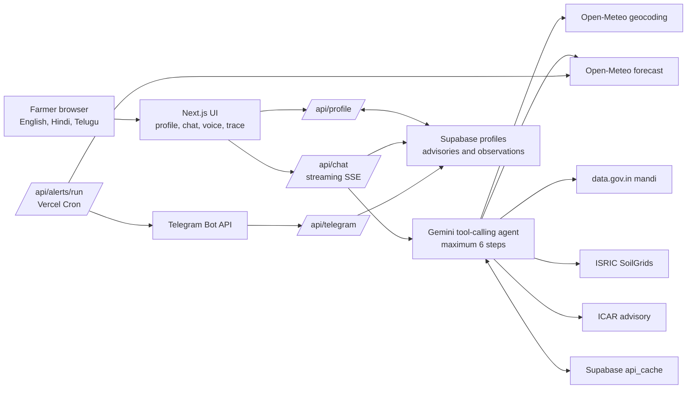

# KisanPilot

KisanPilot is a voice-first, multilingual farm decision agent for small and marginal farmers. It combines a farmer's saved location and crop context with live weather, mandi-price, soil, and official-advisory sources, then shows the source and fetch time behind the answer.

Built for Forge by NxtWave, Theme 2: Climate, Resource Infrastructure & Global Supply Resilience.

## What works today

- A browser-linked farm profile with location, district, state, crops, and language. No login is required.
- Questions in English, Hindi, or Telugu through text or browser speech recognition.
- A streaming Gemini agent that can call live geocoding, forecast, mandi, soil, and official-advisory tools.
- A transparency trace with tool inputs, result state, source, fetch time, and cache age where applicable.
- A mandi trend chart populated only from successful live data.gov.in observations retained by the app.
- Telegram `/link <device_id>` linking and a protected daily alert job for live weather-risk thresholds.

The deployed application is available at [kisanpilot.vercel.app](https://kisanpilot.vercel.app).

## Why it matters

Farm decisions often depend on weather, market arrivals, soil conditions, and seasonal guidance that live in different places. KisanPilot makes those checks visible in one conversation. It does not present a generic, unsourced answer as advice.

## Live data and safety boundaries

| Need | Live source | What KisanPilot shows |
| --- | --- | --- |
| Location and forecast | [Open-Meteo](https://open-meteo.com/) | Coordinates, administrative context, daily rain, temperature, wind, and ET0 |
| Mandi prices | [data.gov.in](https://data.gov.in/) | Market identity, arrival date, minimum, maximum, and modal price |
| Soil profile | [ISRIC SoilGrids](https://soilgrids.org/) | 0–5 cm pH, organic carbon, sand, silt, and clay when available |
| Farm guidance | [ICAR](https://icar.gov.in/en/kharif-agro-advisory-farmers) | Live official-advisory URL and fetch time |

Every external data tool uses an eight-second timeout, one retry with backoff, error handling, and a typed result envelope. Successful responses can be cached with their original fetch time. When a fresh source is unavailable, the interface identifies missing data or labels cached data with its age. KisanPilot never invents weather, prices, soil values, dates, sources, or API responses.

KisanPilot does not provide pesticide or chemical dosage. It directs the farmer to a local KVK or agriculture officer for that advice.

## Architecture

The implementation uses Next.js App Router, TypeScript, Tailwind CSS, Vercel AI SDK with Gemini, Supabase, Telegram Bot API, and browser speech APIs. See the editable [architecture diagram](docs/architecture-diagram.md) for the request and data flow.



## Run locally

1. Install dependencies.

   ```bash
   npm install
   ```

2. Copy `.env.example` to `.env.local` and add real values. Never commit `.env.local`.

   ```bash
   GEMINI_API_KEY=
   DATA_GOV_IN_API_KEY=
   NEXT_PUBLIC_SUPABASE_URL=
   NEXT_PUBLIC_SUPABASE_ANON_KEY=
   SUPABASE_SERVICE_ROLE_KEY=
   TELEGRAM_BOT_TOKEN=
   TELEGRAM_WEBHOOK_SECRET=
   CRON_SECRET=
   ```

3. Apply the SQL migrations in `supabase/migrations/` to the target Supabase project in order.

4. Start the app.

   ```bash
   npm run dev
   ```

5. Open `http://localhost:3000`, save a real farm profile, and ask a question. The source trace appears beneath the answer.

### Telegram webhook setup

Set a non-empty `TELEGRAM_WEBHOOK_SECRET` in both Vercel Preview and Production environments, then re-register the Telegram webhook with that same value as its `secret_token`. KisanPilot rejects webhook updates when the configured secret is absent or the `X-Telegram-Bot-Api-Secret-Token` header does not match. Keep the value only in Vercel and `.env.local`; never commit it.

## Verification commands

```bash
npm run lint
npx tsc --noEmit
npm run build
npm run smoke
```

`npm run smoke` makes live provider checks, so it requires configured Gemini and data.gov.in credentials. The current project handoff and recorded real-call results live in `PROJECT_STATE.md`.

## Submission materials

- [Architecture diagram](docs/architecture-diagram.md)
- [Seven-slide pitch narrative](docs/pitch-deck.md)
- [Seven-slide pitch deck](docs/output/kisanpilot-forge-pitch.pptx)
- [Project brief](PROJECT.md)
- [Architecture specification](ARCHITECTURE.md)
- [Task and verification history](PROJECT_STATE.md)

## Repository structure

```text
app/                 Next.js page and API routes
components/          Mandi trend and UI components
lib/agent/tools/     Typed live-data tools
lib/                 Cache, profile, database, and Telegram helpers
supabase/migrations/ Database schema migrations
scripts/smoke/       Live API smoke checks
docs/                Submission architecture and pitch narrative
```
